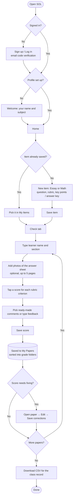

# SOL — Answer Checker for Teachers

> **Scan · Observe · Learn | Suriin · Obserbahan · Linangin**

SOL is a mobile app that helps Philippine public high school teachers check learners' handwritten
answers to **essay questions** and **math problem-solving (show-your-solution) items**, using a
rubric.

The teacher sets up a test item once, then for each learner photographs the answer sheet, taps a
score for each rubric criterion, adds feedback, and saves. SOL adds up the score, gives the
DepEd-style rating, keeps a record of every checked paper, and exports a CSV for the class record.

**The teacher decides every score.** SOL only does the arithmetic, the record-keeping and the
export. No answer is sent anywhere to be graded.

---

## Who it's for

| Role | Who | What they can do |
| --- | --- | --- |
| **Teacher** | Any subject teacher (English, Filipino, Math, Science, AP, …) | Set up items, check papers, correct scores, view and delete their own papers, download their own CSV. |
| **Owner** | The Master Teacher who runs SOL for the school | Everything a teacher can do, plus the **admin dashboard**: see all teachers, who is online, school-wide stats, manage accounts. |

---

## How it works (app flow)



### Step by step

1. **Sign in.** Teachers create an account with their email and confirm it with a code sent by
   email. Forgotten passwords are reset the same way.
2. **Set up your profile.** On first sign-in, enter your name and the subject you teach.
3. **Set up the item** (*Items* tab). Choose **Essay** or **Math**, then enter:
   - the question or problem
   - the rubric: criteria, what earns full points, and points per criterion
   - essay: expected key points and minimum words
   - math: the answer key or expected solution
   - feedback language (English or Filipino)

   Save it once and reuse it for every learner.
4. **Check a paper** (red camera button in the middle of the tab bar).
   - Type the learner's name and section. The section stays filled in for the next learner.
   - Photograph every page of the answer, in order (optional, up to 5). Photos are kept with the
     score as proof.
   - Tap a score for each rubric criterion. The total, percentage and rating update as you go.
   - Tap ready-made strengths and "to improve" comments, or type your own note.
   - Press **Save score**.
5. **Review and correct** (*Papers* tab). Open any paper to see its photos and scores. Tap
   **Edit** to change a score or the feedback, then **Save corrections**. The paper is then
   marked *edited*.
6. **Browse by grade** (*Folders* tab). Papers are grouped into folders by the grade level typed on each item (e.g. "Grade 8").
7. **Export.** In *My Papers*, download a CSV of the filtered papers. It opens correctly in Excel,
   ready to copy into the class record.

### Rating scale

| Percentage | Descriptor |
| --- | --- |
| 90–100 | Outstanding |
| 85–89 | Very Satisfactory |
| 80–84 | Satisfactory |
| 75–79 | Fairly Satisfactory |
| Below 75 | Did Not Meet Expectations |

75% counts as passing in the summaries.

---

## The three parts of this project

```
SOL CHECKER/
├── src/            Mobile app for teachers (Expo / React Native)
│   ├── app/        Screens. Every file is a route (Expo Router)
│   │   ├── (tabs)/ Home, Items, Check, Papers, Folders
│   │   └── …       login, sign-up, verify-email, welcome, settings, help, paper/[id], item/[id]
│   ├── components/ Reusable UI (score picker, rubric editor, photo picker, …)
│   └── lib/        Store, auth, scoring, ratings, CSV export, Supabase client
├── admin/          Web dashboard for owners (Vite + React)
├── backend/        Supabase database: tables, security rules, functions (SQL migrations)
├── docs/           Full product specification
└── assets/         App icon, splash screen, images
```

| Part | What it does | Details |
| --- | --- | --- |
| **Mobile app** (`src/`) | The teacher's app: items, checking, papers, folders, CSV export, account, profile photo. Shows an offline screen when there is no internet. | This file |
| **Admin dashboard** (`admin/`) | For owners: who is online, active today and this week, papers per day, average score, pass rate, managing teachers (make owner, suspend), viewing papers, CSV, maintenance. | [admin/README.md](admin/README.md) |
| **Backend** (`backend/`) | Supabase Postgres tables (`teachers`, `items`, `papers`), row level security so teachers only see their own data, the profile-photo storage bucket, and the `admin_*` functions. | [backend/README.md](backend/README.md) |

### Where data is stored

| Data | Stored in |
| --- | --- |
| Account, name, subject, grade level, profile photo | Supabase (synced) |
| Online status ("last active") | Supabase, via the `heartbeat()` function about once a minute |
| Items, checked papers | On the phone (AsyncStorage) |
| Photos of answer sheets | On the phone only. Deleting a paper deletes its photos. |

> **Note:** the app doesn't upload items and papers to Supabase yet. The admin dashboard's
> teacher and online stats work now. Its paper stats will stay empty until paper syncing is
> added.

---

## Tech stack

- **Expo SDK 58** · React Native 0.88 · React 19 · TypeScript
- **Expo Router** (file-based navigation with protected routes)
- **NativeWind** (Tailwind CSS for React Native)
- **Supabase** (auth with email codes, Postgres, storage)
- expo-camera, expo-image-picker, expo-file-system, expo-sharing, react-hook-form + zod
- Admin dashboard: **Vite + React**

---

## Getting started

### Requirements

- Node.js (LTS)
- A [Supabase](https://supabase.com) project
- The **Expo Go** app on your phone, or an Android/iOS emulator

### 1. Install

```bash
git clone https://github.com/NotJayDee119/sol-checker.git
cd sol-checker
npm install
```

### 2. Configure Supabase

```bash
cp .env.example .env
```

Fill in `.env` with values from **Supabase → Project Settings → API**:

```env
EXPO_PUBLIC_SUPABASE_URL=https://<your-project>.supabase.co
EXPO_PUBLIC_SUPABASE_PUBLISHABLE_KEY=<publishable key>
EXPO_PUBLIC_EMAIL_CODE_LENGTH=8
```

Use the **publishable** key only, never the `service_role` key. If you leave these empty, the
app runs on-device only, with no sign-in.

### 3. Set up the database

```bash
cd backend
npx supabase login
npx supabase link --project-ref <your-project-ref>
npx supabase db push
```

### 4. Run the mobile app

```bash
npx expo start
```

Scan the QR code with Expo Go, or press `a` for Android or `i` for iOS.

### 5. Run the admin dashboard (optional)

```bash
cd admin
cp .env.example .env   # same Supabase URL and publishable key
npm install
npm run dev            # http://localhost:5174
```

Or run `npm run admin` from the project root. See [admin/README.md](admin/README.md) to create
the first owner account.

### Useful commands

| Command | What it does |
| --- | --- |
| `npm start` | Start the Expo dev server |
| `npm run android` / `npm run ios` / `npm run web` | Open on a platform |
| `npm run lint` | Lint |
| `npm run typecheck` | TypeScript check |
| `npm run admin` | Start the admin dashboard |

---

## Privacy and responsible use

- Each teacher's records are private to them.
- Record only the learner's **name and section**. Don't record LRNs, addresses or other personal
  data (Data Privacy Act of 2012, RA 10173).
- Photos of answer sheets stay on the teacher's phone.
- Every score comes from the teacher. SOL never grades on its own.

---

## Documentation

- [docs/SOL-Answer-Checker.md](docs/SOL-Answer-Checker.md): the full product specification
  (screens, data shapes, CSV format, design system). It also describes an **AI-assisted checking**
  design from an earlier web version. The current mobile app uses manual scoring instead.
- [admin/README.md](admin/README.md): admin dashboard setup and security.
- [backend/README.md](backend/README.md): applying database migrations.
