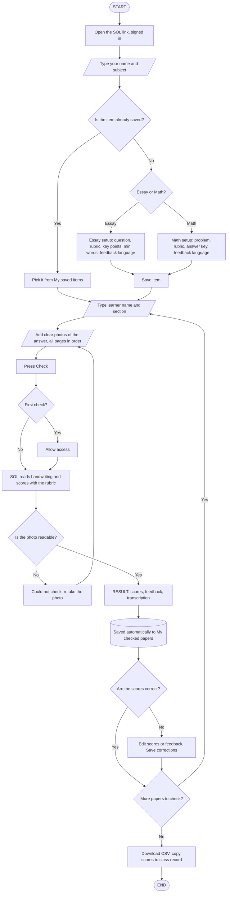

# SOL Answer Checker — Application Specification and Build Prompt

> **SOL — Scan · Observe · Learn | Suriin · Obserbahan · Linangin**
>
> Use this file as the single reference for building, extending or redesigning SOL. It describes what the app is, who uses it, every screen and flow, the data it stores, how the checking works, and the rules the app must follow. Sections marked **Current implementation** describe how the working version is built today.

---

## 1. Purpose

Build a web application called **SOL** that helps Philippine public high school teachers check handwritten answers to **essay-type questions** and **math problem-solving (show-your-solution) items** from a photo.

The teacher:

1. sets up a test item (question + rubric),
2. takes or uploads photos of a learner's answer sheet,
3. receives an AI-generated score per rubric criterion, feedback for the learner, and a transcription of the answer,
4. reviews and, if needed, corrects the score,
5. keeps a private record of all checked papers and downloads it as a CSV for the class record.

**Guiding principle:** SOL *suggests* a score; the teacher *decides* the final score. Every result must be easy to review and correct.

---

## 2. Users and roles

| Role | Who | What they can do |
| --- | --- | --- |
| **Teacher** | Any subject teacher invited to the app (English, Filipino, Mathematics, Science, AP, etc.) | Set up and save their own items, check papers, correct results, view and delete their own papers, download their own CSV. Cannot see other teachers' data. |
| **Owner** | The app owner (a Master Teacher) | Everything a teacher can do, **plus** view every teacher's papers (read-only), filter by teacher, and download a combined CSV with a Teacher column. |

**Access**

- Users must be signed in. Signing in identifies the teacher (to keep records private), gives access to the AI checker, and keeps the app private to invited people.
- Teachers are invited individually by email. **Current implementation:** shared from the Claude artifact Share menu; teachers outside the owner's Claude organization must be invited as **Editors** to save data, and no public link may be enabled (a public link drops outside Editors to view-only).

---

## 3. Complete app flow



### 3.1 Step-by-step

1. **Open SOL** while signed in. The app connects to the database and to the AI checker; a status indicator shows *Saving to database* (green) or a fallback message.
2. **Teacher profile** — type *Your name* (e.g. "Ma'am Reyes") and *Subject you teach*. Saved locally and to the teacher's profile record (debounced, ~900 ms after typing stops).
3. **Choose the item**
   - If saved → pick from **My saved items**; the setup form fills in.
   - If new → choose **Essay** or **Math solution**, fill in the setup form, press **Save item**.
4. **Check a paper** — type learner name and section, add photos (every page, in order), press **Check essay** / **Check solution**.
5. **First check only** — the platform asks the teacher to allow the app to use their AI account. Declining disables checking for that session.
6. **Checking** — the photos and a structured prompt are sent to the AI model. Takes up to about a minute. A **Stop** button cancels.
7. **Readable?** — if the photo is unreadable, blank or not an answer to the question, the result is marked **Could not check** with all scores 0 and a reason; the teacher retakes the photo.
8. **Result** — scores, feedback and transcription are shown and the paper is **saved automatically**. The learner name and photos clear for the next paper; the section stays filled.
9. **Review** — the teacher compares the transcription with the paper, changes any criterion score or the feedback, and presses **Save corrections** (paper is flagged *edited*).
10. **Repeat** for the next learner, or go to **My checked papers** to filter, review and **Download CSV**.

---

## 4. Screens and features

### 4.1 Global layout

- **Header:** SOL wordmark, the acronym line (*Scan · Observe · Learn | Suriin · Obserbahan · Linangin*), one-sentence description, database status chip.
- **How to use (for teachers):** collapsible 5-step guide plus a privacy note.
- **Teacher bar:** *Your name*, *Subject you teach*, and a role note (owner: "you can see every teacher's papers"; teacher: "your papers are private").
- **Main area:** two panels side by side on desktop, stacked on mobile:
  - **1 · Set up the item** (left)
  - **2 · Check a paper** + result (right)
- **Records panel** (full width, below).
- Redesign target (optional): desktop sidebar (Home, Check a Paper, My Items, My Papers, Help, owner: All Teachers); mobile bottom navigation with a central red camera "Check" button.

### 4.2 Item setup panel

| Field | Essay | Math | Notes |
| --- | --- | --- | --- |
| My saved items (dropdown) | ✓ | ✓ | Lists the teacher's items as "Title · Type". Selecting one loads it. |
| Save item / New | ✓ | ✓ | Save overwrites the loaded item, or creates a new one. New clears the form (keeps type). |
| Type of item | Essay | Math solution | Radio cards. Switching type swaps in the sample question/rubric **only if** the teacher hasn't changed them. |
| Item name | ✓ | ✓ | Required to save. |
| Question / Math problem | ✓ | ✓ | Required to check. |
| Grade level / subject | ✓ | ✓ | |
| Feedback language | ✓ | ✓ | English · Filipino · English with Filipino explanation · Same language as the learner's answer |
| Rubric | ✓ | ✓ | Rows of *criterion name*, *what earns full points*, *points*; remove (min 1 row); **+ Add criterion**; **Use the sample rubric**; auto **Total points**. |
| Expected key points | ✓ (optional) | — | |
| Answer key / expected solution | — | ✓ (recommended) | |
| Minimum words | ✓ (optional) | hidden | |
| Checking strictness | ✓ | ✓ | Lenient · Balanced (default) · Strict |

The current setup is auto-saved as a local draft in the browser (per device) so a refresh doesn't lose it.

**Sample items (defaults)**

- **Essay — "Effective Communication – Essay"** (Grade 11): *"In not less than 150 words, explain why effective communication is important in the workplace. Give at least two examples from your own experience or observation."* Rubric: Content and relevance 10 · Organization 5 · Language use and mechanics 5 (= 20). Minimum 150 words.
- **Math — "Fractions – Word Problem"** (Grade 7): *"A farmer harvested 1,250 kg of rice and sold 3/5 of it at ₱42 per kilogram. How much did the farmer earn from the rice sold? Show your complete solution."* Answer key: 3/5 × 1,250 kg = 750 kg; 750 kg × ₱42 = ₱31,500. Rubric: Understanding the problem 2 · Strategy and method 3 · Accuracy of computation 3 · Final answer (with label/unit) 2 (= 10).

### 4.3 Check a paper panel

- **Learner name** (defaults to "Unnamed learner" if blank) and **Section**.
- **Photo drop zone:** tap to pick files, drag and drop, or paste. Accepts JPEG, PNG, WebP, GIF. Max photos per paper = platform limit (default 5). Thumbnails show page numbers (p.1, p.2…) and a remove ✕.
- **Check button** label follows the type (*Check essay* / *Check solution*). Disabled while checking; **Stop** appears during a check.
- **Status line** for progress, success and error messages.
- On first load, an **Example result** (marked as an example) is shown for the selected type so the screen is never empty.

### 4.4 Result view

Common to both types:

- Tags: *Example result* (if example), type, *Could not check* (if unreadable).
- Learner name, section; rating descriptor and percentage; meta line (checked by, item, word count, legibility, date/time).
- **Score mark:** total/max in red handwritten style inside a circle.
- **Issue** box (when unreadable).
- **Per-criterion** score with progress bar and reason.
- **Strengths** and **To improve**.
- **Feedback for the learner** with **Copy** (clipboard; falls back to selecting text).
- **Transcription** (collapsible), with `[illegible]` highlighted.
- **Teacher check** note.

Essay only: word count (flag when below minimum), **Key points present / missing**, **Language errors** table (As written · Correct · Type; max 8).

Math only: **Learner's answer** with ✓/✗, **Correct answer** (when wrong), **First error** callout, **Step-by-step check** (✓ correct · ✗ error · ? unclear, with comment; max 12 steps), **Possible misconceptions** (max 6); transcription in monospace.

**Editing (own papers only):** each criterion score becomes a number input (clamped 0…max); total, bar and descriptor update live; feedback becomes a textarea; **Save corrections** writes the change and sets `edited: true`.

### 4.5 Records panel ("My checked papers")

- **Filters:** Teacher (owner only: My papers / All teachers / each teacher), Item, Section, Learner search; **Refresh** (owner).
- **Summary:** Papers, Average %, Highest %, Lowest %, At 75% or above (count of total).
- **Table:** (Teacher — non-"mine" views) · Learner (+ *edited* tag) · Section · Item (+ "(Math)") · one column per criterion **only when all shown rows share the same rubric** · Score · % · Checked date · actions **View**, **Delete** (own papers only; two-click confirm: *Delete* → *Confirm delete*).
- **Empty states:** "No papers checked yet…", "No papers match these filters.", "No papers found for this teacher yet."
- **Download CSV:** exports the filtered rows (see §7.4).

---

## 5. Rating scale

| Percentage | Descriptor |
| --- | --- |
| 90–100 | Outstanding |
| 85–89 | Very Satisfactory |
| 80–84 | Satisfactory |
| 75–79 | Fairly Satisfactory |
| Below 75 | Did Not Meet Expectations |

`percent = round(total / max × 100)`; 75% is used as the "at or above" threshold in summaries.

---

## 6. The checking process (AI)

### 6.1 Request

- One call per paper, sending **all photos** (in page order) plus a text prompt built from the item setup.
- Response must be **JSON only** (parsed tolerantly).
- Model tier: *default* for essays, *complex* (most capable) for math.
- The call is cancellable; it is never retried automatically.
- **Current implementation:** the artifact `sample` capability — `sample.json(prompt, { images, signal, modelTier })`; `sample.limits()` reports whether images are supported and how many.

### 6.2 Essay prompt (summary of instructions)

Role: an experienced Filipino teacher checking a handwritten essay answer (English, Filipino or another Philippine language). Includes question, level/subject, minimum length, expected key points, rubric (criteria with max points and descriptors). Instructions:

1. Transcribe exactly as written, keeping errors; `[illegible]` for unreadable words; never correct the transcription.
2. Score each criterion with a whole number 0…max based only on what is written; apply the strictness rule.
3. Judge language errors by the rules of the language used (Filipino: KWF orthography).
4. Unreadable / blank / off-question → `readable: false`, all scores 0, reason in `issue`.
5. Learner feedback in the chosen language: warm, specific, 3–5 sentences, one strength and one next step.
6. Teacher notes may be in English.

Expected JSON:

```json
{
  "readable": true, "issue": "", "transcription": "...", "word_count": 0,
  "criteria": [{ "name": "", "score": 0, "max": 0, "reason": "" }],
  "key_points_found": [], "key_points_missing": [],
  "strengths": [], "improvements": [],
  "errors": [{ "wrong": "", "correct": "", "type": "spelling|grammar|punctuation|word choice" }],
  "learner_feedback": "", "teacher_note": "", "legibility": "good|fair|poor"
}
```

### 6.3 Math prompt (summary of instructions)

Role: an experienced Filipino mathematics teacher. Includes problem, level/subject, answer key (or "solve it yourself"), rubric. Instructions:

1. Work out the correct solution first; follow the answer key if given, and flag any disagreement in `teacher_note`.
2. Transcribe the work line by line, including mistakes, in plain-text math (`/` fractions, `^` exponents, `×`, `÷`, `√`, units and ₱); `[illegible]` where unreadable.
3. Check every step: `correct` / `error` / `unclear`. Accept any valid method. **Follow-through credit:** a step wrong only because of an earlier error, with correct method, is marked correct ("follows from the earlier error").
4. Name the first wrong step; state the learner's final answer and whether it is correct (equivalent forms allowed; check units/labels).
5. Score each criterion 0…max; apply strictness.
6. Unreadable / blank / off-problem → `readable: false`, scores 0, `issue`.
7. Learner feedback in the chosen language: encouraging, specific, 3–5 sentences, pointing to the exact step to fix.

Expected JSON:

```json
{
  "readable": true, "issue": "", "transcription": "line 1\nline 2",
  "steps": [{ "work": "", "status": "correct|error|unclear", "comment": "" }],
  "first_error": "", "final_answer": "", "final_answer_correct": true, "correct_answer": "",
  "criteria": [{ "name": "", "score": 0, "max": 0, "reason": "" }],
  "misconceptions": [], "strengths": [], "improvements": [],
  "learner_feedback": "", "teacher_note": "", "legibility": "good|fair|poor"
}
```

### 6.4 Strictness wording

- **Lenient:** give credit for sound ideas and reasoning; small slips cost little.
- **Balanced:** fair and balanced, as an experienced teacher would.
- **Strict:** apply every rubric descriptor exactly.

### 6.5 Normalizing the AI response (never trust it blindly)

- Map criteria **by position** to the teacher's rubric; criterion names and max points always come from the rubric, not the AI.
- `score = clamp(round(score), 0, max)`; all scores 0 when `readable` is false.
- `total = sum(scores)`, `max = sum(maxes)`, `pct = round(total/max×100)`.
- Arrays coerced to strings and capped (lists 12, errors 8, steps 12, misconceptions 6); step status outside the allowed set → `unclear`.
- `word_count` falls back to counting words in the transcription.
- Missing fields default to empty strings/arrays.

---

## 7. Data

### 7.1 Storage layout (per teacher, private)

```
t/{teacherId}                      teacher profile document
t/{teacherId}/items/{itemId}       saved items
t/{teacherId}/papers/{paperId}     checked papers
```

`teacherId` is the signed-in user's opaque id from the platform. Never store display names from the platform; the teacher's *typed* name is stored in their profile.

### 7.2 Access rules

| Path | Read | Write |
| --- | --- | --- |
| everything (root) | owner only | owner only |
| `t` (all teachers) | owner only | owner only |
| `t/{self}` (own subtree) | the teacher (Contributor/Editor level) | the teacher |

Result: each teacher reads and writes only their own subtree; the owner can read every teacher's subtree; Editors cannot read each other's data. **Current implementation:** artifact `db` capability rules
`[{path:"", read:"owner", write:"owner"}, {path:"t", read:"owner", write:"owner"}, {path:"t/{self}", read:"interact", write:"interact"}]`.

### 7.3 Document shapes

**Teacher profile** `t/{id}`

```json
{ "teacherName": "Ma'am Reyes", "subject": "Filipino 8", "lastActive": 1763100000000 }
```

**Item** `t/{id}/items/{itemId}`

```json
{
  "kind": "essay | math", "title": "", "q": "", "grade": "", "key": "",
  "words": 0, "lang": "English", "strict": "lenient | balanced | strict",
  "rubric": [{ "name": "", "desc": "", "pts": 10 }],
  "updatedAt": 1763100000000
}
```

**Paper** `t/{id}/papers/{paperId}` — common fields

```json
{
  "kind": "essay | math", "learner": "", "section": "",
  "itemId": "", "itemTitle": "", "question": "",
  "readable": true, "issue": "", "transcription": "",
  "criteria": [{ "name": "", "max": 10, "score": 8, "reason": "" }],
  "total": 15, "max": 20, "pct": 75,
  "strengths": [], "improvements": [],
  "feedback": "", "note": "", "legibility": "good",
  "checkedAt": 1763100000000, "edited": false, "editedAt": null
}
```

Essay adds: `word_count`, `minWords`, `found[]`, `missing[]`, `errors[{wrong, correct, type}]`.
Math adds: `steps[{work, status, comment}]`, `firstError`, `finalAnswer`, `finalCorrect`, `correctAnswer`, `misconceptions[]`.

Photos are **never stored** — only the results.

### 7.4 CSV export

- UTF-8 with BOM (opens correctly in Excel), CRLF line endings, every value quoted.
- File name: `sol-scores-YYYY-MM-DD.csv`.
- Columns: `[Teacher]` (non-"mine" views only), Learner, Section, Item, Type, then for each criterion position *Criterion n*, *Score n*, *Max n*, then Total, Max, Percent, Edited, Checked, Feedback.
- Exports only the rows currently shown by the filters. The viewer confirms the save.

### 7.5 Loading and limits

- Own papers: live subscription, newest first, latest **1,000**. Own items: live subscription, latest 500.
- Owner views of other teachers: loaded on demand (one query per teacher) with a **Refresh** button.
- Whole database: up to **25,000** documents (papers + items + teacher profiles). Plan: export CSV each quarter and delete old papers; one copy of SOL per school.
- Photos: platform-limited count per check; each file up to ~20 MB; images are downsized before sending.

---

## 8. Messages and error handling

| Situation | Message to the teacher |
| --- | --- |
| No photo | Add at least one photo of the answer first. |
| No question | Type the question first. |
| AI not available in this view | Checking needs Claude, which isn't available in this view. Open this page in Claude while signed in. |
| Images not supported | This view can't send photos to Claude. Open the page in the Claude app or website. (Check button disabled.) |
| Declined permission | Claude wasn't allowed for this page, so papers can't be checked here. |
| Rate / usage limit | Too many checks in a short time, or your Claude usage limit was reached. Wait a while, then try again. |
| Bad photo file | One of the photos couldn't be used. Try a JPG or PNG under 20 MB. |
| AI refused | Claude couldn't check this paper. Try a clearer photo. |
| Incomplete JSON | The result came back incomplete. Press Check to try again. |
| Session expired | Your session expired. Sign in again, then retry. |
| Stopped | Stopped. |
| Saved | Checked and saved. Review the marks below. |
| Checked, save failed | Checked, but not saved: *reason* |
| No write permission | You don't have permission to save in this app. Ask the person who shared it to give you Editor access. |
| Database full | The database is full. Delete old papers, then try again. |
| Too many saves | Too many saves at once. Wait a moment and try again. |
| Database unavailable | Database not available — results kept until you close the page (local mode). |
| Not signed in | Sign in to save your papers. |

**Local mode:** if the database is unavailable, checking still works; results are kept in memory for the session only, and the teacher is told to download the CSV.

Never retry failed AI or database calls in a loop; let the teacher retry.

---

## 9. Privacy and responsible use

- Each teacher's records are private; only the owner can see all teachers' records.
- Record only learner name and section — no LRNs, addresses or other personal data (Data Privacy Act of 2012, RA 10173).
- Photos are not stored.
- AI scores are suggestions; teachers must review every result, especially low scores and answers with `[illegible]` words.
- Each check uses the signed-in teacher's own AI usage; the first check asks for permission.

---

## 10. Design system

- **Colors:** ink navy `#1B2638` · red-pen red `#C8312B` (primary actions, scores) · blue `#2B5FA8` (links, progress, selection) · background `#F3F5F8` · surface `#FFFFFF` · border `#D9E1EC` · muted `#5D6B80` · success `#1F7A4D` · warning `#A66A00` · red tint `#FBE9E7` · blue tint `#E6EEF9`. Full dark theme with matching tokens.
- **Type:** Bricolage Grotesque (headings) · Source Sans 3 (body, 16px) · IBM Plex Mono (scores, math, numbers, tabular figures) · Caveat (handwritten score mark and ✓/✗ ticks).
- **Components:** primary button solid red; secondary outlined; text links blue; cards with 1px border and 10px radius; pill chips; dashed upload zone; lined-paper transcription panel.
- **Responsive:** works from 390px phones to 1440px desktops; panels stack on narrow screens; wide tables scroll inside their container; 16px side gutter; no horizontal page scroll.
- **Accessibility:** WCAG AA contrast, visible focus states, labels on every field, keyboard-operable upload zone, reduced-motion support.

---

## 11. Acceptance checklist

- [ ] A teacher can set up, save, load and reuse Essay and Math items.
- [ ] Switching type swaps sample content only when the teacher hasn't edited it.
- [ ] Checking a paper with 1–5 photos returns a result in about a minute and saves it automatically.
- [ ] Unreadable photos return *Could not check* with 0 scores and a reason.
- [ ] Scores are always clamped to the rubric; totals and percentages are computed by the app, not the AI.
- [ ] Math results show final answer ✓/✗, first error and step check with follow-through credit.
- [ ] Teachers can correct scores and feedback; corrected papers show *edited*.
- [ ] Teachers see only their own papers; the owner can see all, read-only for others' papers.
- [ ] Filters, summary stats and CSV export match the rows shown.
- [ ] Delete requires a second confirming click.
- [ ] The app degrades gracefully when the AI or database is unavailable.
- [ ] Layout works on phone and desktop in light and dark themes.

---

## 12. Current implementation notes

- Single self-contained HTML page published as a **Claude artifact** (private, shared by invitation).
- Runtime capabilities: `sample` (AI checking with images), `db` (per-teacher storage with the rules in §7.2), `user` (viewer id, owner check, display names for the owner view), `downloads` (CSV save).
- Browser `localStorage` holds only per-device conveniences: the setup draft (`snapcheck-setup`) and the teacher name/subject (`snapcheck-teacher`).
- No external servers or databases; an external database (e.g. Supabase) would require a separate sync process because the page cannot call outside services directly.
